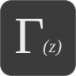

  

<h1 align="center">Mostly Math</h1>

<em>Mathematical thought experiments.</em>

Mostly Math is a collection of notebook ideas to explore mathematical questions, follow the ideas, calculations, and the unexpected connections with other concepts in a light read.

One can think of it as some sophisticated mathematical fun facts always driven by curiosity (and boredoom).

## Credits

Built with [Hugo](https://gohugo.io/) and based on [Stack theme](https://github.com/CaiJimmy/hugo-theme-stack) (GPL-3.0). Graphs powered by [JSXGraph](https://jsxgraph.org/) (MIT / LGPL-3.0 or later) and images mainly provided by [Wikimedia Commons](https://commons.wikimedia.org/).
